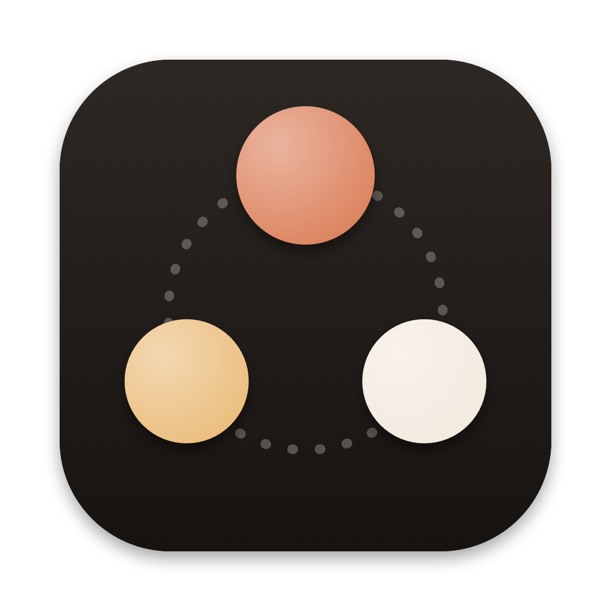
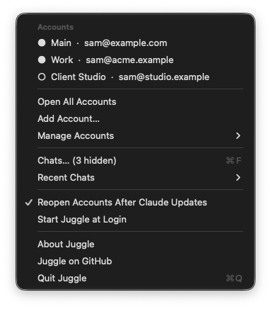
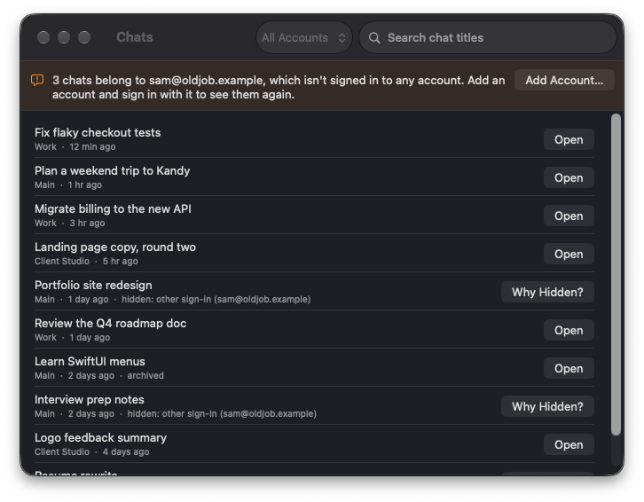

<p align="center"></p>

<h1 align="center">Juggle</h1>

<p align="center">Run several Claude desktop accounts side by side on your Mac.</p>

Juggle is a small menu bar app for people with more than one Claude account: work and personal, two clients, a team seat and your own Pro plan. Each account gets its own Claude window and sign-in, all open at the same time.

It's an unofficial community tool. It isn't made by, affiliated with or endorsed by Anthropic.

<p align="center"> </p>
<p align="center"><sub>Screenshots use demo data (<code>JUGGLE_DEMO=1</code>).</sub></p>

## The problem

The Claude desktop app signs in to one account at a time. The usual workaround is to start a second copy with Chromium's `--user-data-dir` flag, and it mostly works, but:

- Clicking Claude in the Dock or Finder just focuses the copy that's already open. You need a script or a terminal to open the other one.
- When Claude updates, it quits every copy and reopens only one.
- Chats seem to disappear. Claude lists only the chats of the account that's signed in right now, so chats made under another sign-in, or in the other copy, don't show.
- Nothing stops you opening the same account twice, and two copies writing to one profile can step on each other's data.

## What it does

- The menu lists your accounts with the email each one is signed in as, and a filled dot for the ones that are open. Click one to open it or bring it to the front.
- When Claude updates and quits everything, Juggle reopens every account that was open.
- Juggle never opens an account twice. If something else already did, it offers to quit the extra copy.
- The Chats window searches every account and tells you where each chat lives and why one might be hidden. If an account's chats are stuck in another account's folder, Bring Chats copies them across.
- You can add, rename and remove accounts from the menu. Removing moves the account's folder to the Trash, so you can put it back.
- Juggle can start at login if you turn that on.

## Install

You need macOS 15 or later and the [Claude desktop app](https://claude.ai/download).

### Download

1. Get `Juggle.zip` from the [latest release](https://github.com/Harindulk/juggle/releases/latest) and unzip it.
2. Drag **Juggle.app** into **Applications** and open it.
3. Juggle isn't signed with a paid Apple Developer ID, so the first time macOS says it can't check it. Open **System Settings → Privacy & Security**, scroll down and click **Open Anyway** next to Juggle. You only do this once.

If you'd rather skip that, build it yourself with one command (below).

### Build from source

All you need is Apple's free Command Line Tools (`xcode-select --install`); Xcode isn't required.

```bash
git clone https://github.com/Harindulk/juggle.git
```

```bash
cd juggle && ./build.sh install
```

`build.sh` runs the self-check, builds a universal app (Apple silicon and Intel) and copies it to `/Applications`.

## Using it

Look for the three-ball icon in the menu bar.

### Adding an account

Choose **Add Account…**, give it a name and sign in in the new Claude window. If you sign in through the browser, the link back to Claude can land in an account that's already open. Juggle offers to quit the others while you sign in; choose **Done Signing In** afterwards to bring them back.

### If you already use `--user-data-dir`

Juggle picks up any folder named `Claude-<something>` in `~/Library/Application Support` that Claude has used, so your existing second account shows up on its own.

### Finding missing chats

Open **Chats…** from the menu. Hidden chats are marked and **Why Hidden?** explains each one. The usual reasons:

- The chat is archived. Show archived chats in Claude's sidebar.
- It was made while a different account was signed in to that window. Add that account in Juggle, sign in, and use **Bring Chats**.
- It's in another account's folder. **Bring Chats** copies it to the account it belongs to.

## How it works

Every account is the official Claude app. Juggle starts it with `open -n -a Claude.app --args --user-data-dir=<folder>`, so nothing is patched, copied or re-signed. The default account uses Claude's normal folder, `~/Library/Application Support/Claude`; the others use `~/Library/Application Support/Claude-<Name>`.

What Juggle reads, all on your Mac:

- the process list, to see which accounts are open
- each account's `config.json`, for the signed-in account ID
- chat summaries in `claude-code-sessions/`, for titles and dates
- Claude's local IndexedDB cache, to show the account's email. This is a best guess from an internal format; if Claude changes it, Juggle just shows no email.

What it writes: new account folders you add, chat files you copy with **Bring Chats** (copies, never moves), account folders you remove (moved to the Trash) and its own settings in `~/Library/Application Support/Juggle`. There's also a short `juggle.log` in that folder, with one line per Claude update and what Juggle reopened. It never connects to the internet; the only links it opens are ones you click, in your browser.

The first time Juggle brings back a Claude window you'd closed, macOS asks whether Juggle may control Claude. That's the same "reopen" signal the Dock sends when you click an app.

## Known limits

- Every account shows the same Claude icon in the Dock and app switcher. Changing that means modifying Claude.app, which breaks its code signature and some features, so Juggle doesn't.
- Reopening after an update depends on how Claude's updater behaves, which can change between releases. If an update ever leaves an account closed, `juggle.log` shows what Juggle saw; please open an issue with it.
- Emails come from Claude's cache and appear a few seconds after an account has loaded claude.ai at least once.
- macOS only.

## Uninstall

Quit Juggle from its menu and move `/Applications/Juggle.app` to the Trash. Your Claude accounts and chats stay where they are. To remove Juggle's settings too, delete `~/Library/Application Support/Juggle`.

## Contributing

To take screenshots without your own accounts in them, run Juggle with made-up data: `JUGGLE_DEMO=1 build/Juggle.app/Contents/MacOS/Juggle` opens the Chats window, and `JUGGLE_DEMO=menu` opens the menu. Demo mode never opens, quits or copies anything.


Bug reports and pull requests are welcome. Run `./build.sh` before sending a change; it fails if the self-check in `Tests/main.swift` does.

## License

[MIT](LICENSE). Claude is a trademark of Anthropic, PBC. Juggle is an independent project.
